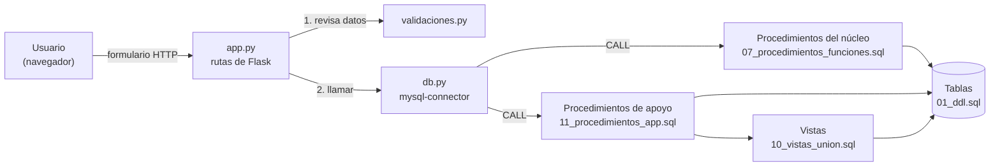

# Documento de arquitectura

Este documento explica cómo la aplicación web usa la base de datos `coworking_db`.
Las instrucciones para instalarla están en el [README](../../README.md).

---

## 1. Visión general

La aplicación tiene tres capas. Cada una solo habla con la siguiente.



*Figura 1. Capas de la aplicación.*

| Archivo | Responsabilidad |
|---|---|
| `app/app.py` | Recibe cada petición del navegador, valida el formulario, llama un procedimiento y muestra el resultado |
| `app/validaciones.py` | Revisa formato, rangos y campos obligatorios antes de ir a la base de datos |
| `app/db.py` | Abre la conexión, ejecuta el procedimiento y traduce los errores de MySQL a mensajes claros |
| `app/templates/` | Páginas HTML (plantillas Jinja) |
| `sql/07_procedimientos_funciones.sql` | El núcleo: las transacciones de cliente, reserva, pago y cancelación, y las funciones de valor y saldo |
| `sql/11_procedimientos_app.sql` | Lo que la aplicación necesita y el núcleo no tiene: consultas para las pantallas, editar y eliminar |
| `sql/10_vistas_union.sql` | Las vistas que arman la ficha de cliente, el catálogo de espacios y el resumen de reservas |

**En el código Python no hay SQL.** La aplicación solo conoce nombres de procedimientos y sus parámetros.
Si mañana cambia una tabla, se ajusta el procedimiento y la aplicación sigue igual.

---

## 2. Cómo se conecta la aplicación a la base de datos

- **Librería:** `mysql-connector-python`, el conector oficial de MySQL para Python.
- **Credenciales:** se leen del archivo `.env` con `python-dotenv`. Ese archivo no se sube a GitHub; en el repositorio solo está `.env.example`, sin contraseña.
- **Una conexión por operación:** `db.llamar()` abre la conexión, ejecuta un procedimiento y la cierra en un `finally`, haya error o no. Para una aplicación con pocos usuarios es lo más simple y no deja conexiones abiertas.
- **`autocommit=True`:** la aplicación nunca abre transacciones. Cada procedimiento que modifica varias tablas abre la suya con `START TRANSACTION` y la cierra con `COMMIT` o `ROLLBACK`.
- **Llamada:** `cursor.callproc(nombre, parametros)`. Los resultados de los `SELECT` del procedimiento se leen con `cursor.stored_results()`. Los parámetros `OUT`, por ejemplo el id de la reserva creada, llegan en la tupla que devuelve `callproc`.
- **Listas:** MySQL no recibe listas como parámetro. Los espacios de una reserva y los teléfonos de un cliente se envían como un arreglo JSON, por ejemplo `'[6, 1, 2]'`, y el procedimiento lo lee con `JSON_TABLE`.

```python
# Así crea una reserva app.py (resumido)
_, salida = llamar("sp_crear_reserva", cliente_id, modalidad_id,
                   json.dumps([6, 1]), fecha, hora_inicio, hora_fin,
                   num_cuotas, metodo_pago, None)
reserva_id = salida[-1]   # parámetro OUT p_reserva_id
```

### Procedimientos que usa la aplicación

| Operación | Procedimiento | Tablas que modifica |
|---|---|---|
| **Crear cliente** (transacción) | `sp_registrar_cliente` (núcleo) | CLIENTE, PERSONA_NATURAL o EMPRESA, TELEFONO_CLIENTE |
| **Crear reserva** (transacción) | `sp_crear_reserva` (núcleo) | RESERVA, RESERVA_ESPACIO, CUOTA |
| **Registrar pago** (transacción) | `sp_registrar_pago` (núcleo) | CUOTA y RESERVA |
| Cancelar reserva | `sp_cancelar_reserva` (núcleo) | RESERVA |
| Consultar catálogos y espacios | `sp_app_listar_catalogos`, `sp_app_listar_espacios` | — |
| Consultar clientes | `sp_app_listar_clientes`, `sp_app_obtener_cliente` | — |
| Actualizar cliente | `sp_app_actualizar_cliente` | CLIENTE, subclase, TELEFONO_CLIENTE |
| Eliminar cliente | `sp_app_eliminar_cliente` | CLIENTE (y en cascada subclase y teléfonos) |
| Consultar reservas | `sp_app_listar_reservas`, `sp_app_detalle_reserva` | — |
| Finalizar reserva | `sp_app_finalizar_reserva` | RESERVA |
| Eliminar reserva | `sp_app_eliminar_reserva` | RESERVA (y en cascada espacios y cuotas) |

Las operaciones principales usan los procedimientos del núcleo, como pide el enunciado. Así la aplicación aplica exactamente las mismas reglas que se demuestran en `08_transacciones.sql` y que prueba `tests/test_transacciones.py`.

---

## 3. Dónde vive la transacción, y por qué

Las transacciones están **dentro de los procedimientos**, no en Python.

Había dos opciones:

| Opción | Ventaja | Problema |
|---|---|---|
| La aplicación abre la transacción y ejecuta varios `INSERT` | El flujo se lee en Python | Obliga a escribir SQL en la aplicación, que el proyecto no permite. Y otra aplicación podría olvidar el `ROLLBACK` |
| **El procedimiento abre y cierra la transacción** (la elegida) | La regla "todo o nada" queda en la base de datos y se cumple sin importar quién la llame | El flujo se lee en SQL |

Todos los procedimientos que modifican varias tablas siguen el mismo esquema:

```sql
DECLARE EXIT HANDLER FOR SQLEXCEPTION
BEGIN
    ROLLBACK;   -- deshace todo lo que alcanzó a hacer
    RESIGNAL;   -- y devuelve el error original a quien llamó
END;

-- validaciones de entrada con SIGNAL ...
START TRANSACTION;
-- INSERT / UPDATE en varias tablas, con validaciones intermedias ...
COMMIT;
```

Cualquier error después de `START TRANSACTION` cae en el handler: un `SIGNAL` propio, una llave foránea, un `CHECK` o un valor repetido.
El handler hace `ROLLBACK` y con `RESIGNAL` le pasa a la aplicación el mismo error con su mensaje.
Sin `RESIGNAL` el error se perdería y la aplicación creería que todo salió bien.

`sp_crear_reserva` y `sp_registrar_pago` además bloquean con `SELECT ... FOR UPDATE` los espacios o la reserva que van a tocar. Si dos personas intentan reservar el mismo espacio al mismo tiempo, la segunda espera a que termine la primera y entonces detecta el cruce.

---

## 4. Flujo de una operación de punta a punta: crear una reserva

```mermaid
sequenceDiagram
    actor U as Usuario
    participant A as app.py
    participant V as validaciones.py
    participant D as db.py
    participant P as sp_crear_reserva
    participant BD as Tablas

    U->>A: POST /reservas/nueva (formulario)
    A->>V: validar_reserva(datos, espacios)
    alt hay errores de formato
        V-->>A: lista de errores
        A-->>U: muestra los errores (no se toca la base)
    else datos válidos
        A->>D: llamar("sp_crear_reserva", ..., '[1, 6]', ...)
        D->>P: CALL con 9 parámetros
        P->>BD: valida cliente, modalidad, fecha, espacios, sede y horario
        P->>BD: START TRANSACTION y bloquea los espacios (FOR UPDATE)
        P->>BD: INSERT reserva (PENDIENTE)
        P->>BD: INSERT reserva_espacio con la tarifa vigente
        P->>BD: ¿todos tenían tarifa? ¿algún cruce de horario?
        alt todo salió bien
            P->>BD: INSERT cuotas, paga la cuota 1 si hay método
            P->>BD: COMMIT
            P-->>D: OUT p_reserva_id
            D-->>A: (tablas, salida)
            A-->>U: redirige al detalle: "Reserva N creada"
        else un espacio está ocupado (u otro error)
            P->>BD: SIGNAL → handler → ROLLBACK
            P-->>D: error 1644 con el mensaje
            D-->>A: ErrorBD("El espacio SR-01 ya está reservado...")
            A-->>U: muestra el mensaje; el formulario conserva los datos
        end
    end
```

*Figura 2. Crear una reserva, con el camino de éxito y el de error.*

Paso a paso, en el caso de error:

1. El usuario marca el escritorio EF-01 y la sala SR-01 para el mismo día, de 11:00 a 13:00. La sala ya está reservada de 9:00 a 12:00.
2. `validaciones.py` no puede saberlo, porque depende de otras reservas. Los datos tienen buen formato y pasan.
3. El procedimiento abre la transacción, inserta la reserva y las dos filas de RESERVA_ESPACIO.
4. Al buscar cruces encuentra el de SR-01 y lanza `SIGNAL SQLSTATE '45000'`.
5. El handler hace `ROLLBACK`: desaparecen la fila de RESERVA y las dos de RESERVA_ESPACIO, también la del escritorio, que estaba libre.
6. `db.py` recibe el error 1644 y usa como mensaje el texto del `SIGNAL`.
7. La página sube hasta el mensaje *"El espacio SR-01 ya está reservado en un horario que se cruza"* y conserva lo que el usuario escribió.

La prueba `test_rollback_reserva_con_cruce_muestra_el_mensaje_y_no_guarda_nada` reproduce este caso desde el formulario y comprueba que las 7 tablas quedan con las mismas filas que antes.

---

## 5. Manejo de errores

El usuario nunca ve un error técnico de MySQL. `db.traducir_error()` convierte cada uno en un mensaje claro:

| Código MySQL | Cuándo pasa | Mensaje que ve el usuario |
|---|---|---|
| 1644 | Un `SIGNAL SQLSTATE '45000'` de un procedimiento | El texto escrito en el `SIGNAL`, por ejemplo *"La reserva 188 tiene pagos registrados; cancelarla requiere un reembolso"* |
| 1062 | Valor repetido en una columna `UNIQUE` | *"Ese dato ya está registrado y no se puede repetir."* |
| 1451 / 1452 | Se rompe una llave foránea | *"La operación rompe una relación con otros datos (llave foránea)."* |
| 3819 | No se cumple un `CHECK` | *"Un valor no cumple las reglas de la base de datos (restricción CHECK)."* |
| 1045, 1049, 2003, 2005 | No hay conexión, el usuario o la contraseña están mal, o la base no existe | *"No fue posible conectarse a la base de datos. Revise que MySQL esté encendido y los datos del archivo .env."* |
| 1305 | Falta un procedimiento | *"Falta un procedimiento en la base de datos. Ejecute los scripts SQL en el orden del README."* |
| Cualquier otro | — | *"Error de la base de datos (código). No se guardaron cambios."* |

En la práctica casi todo llega como 1644: los procedimientos revisan antes las condiciones que harían fallar a MySQL (documento repetido, espacio sin tarifa) y responden con su propio mensaje. Los demás códigos son la red de seguridad.

Cuando falla un formulario, el mensaje se muestra en la misma página, la página sube hasta él y el formulario conserva lo que el usuario escribió.

### Cómo funciona SIGNAL SQLSTATE

`SIGNAL SQLSTATE '45000' SET MESSAGE_TEXT = '...'` lanza un error a propósito desde un procedimiento.
El estado `45000` significa "excepción definida por el usuario" y MySQL lo entrega con el código 1644.
Sirve para detener el procedimiento en cuanto una entrada es inválida (una reserva que no existe, un espacio ocupado), en vez de dejar que siga y falle en silencio o con un mensaje confuso.
Como es un error de verdad, también activa el `EXIT HANDLER` y provoca el `ROLLBACK`.

---

## 6. Validaciones: cuáles van en la aplicación y cuáles en la base de datos

| Validación | Aplicación | Base de datos | Por qué ahí |
|---|---|---|---|
| Campos obligatorios | Sí | `NOT NULL` y `SIGNAL` | La aplicación avisa todos los campos que faltan a la vez; la base es la red de seguridad |
| Formato de email, teléfono (7 o 10 dígitos) y NIT | Sí | Sí (`REGEXP_LIKE` y `SIGNAL`) | La aplicación responde sin gastar una consulta; la base lo exige aunque alguien la use sin la aplicación |
| Formato del documento | Sí | No | Regla del formulario |
| Mayor de edad | Sí | Sí (`SIGNAL`) | Igual que el formato |
| Fecha de reserva futura, hora fin > hora inicio | Sí | Sí (`SIGNAL` y `CHECK (fin > inicio)`) | Igual que el formato |
| Al menos un espacio, sin repetidos; de 1 a 3 cuotas; método de pago válido | Sí | Sí (`SIGNAL`) | Igual que el formato |
| Tipo de cliente, estado, modalidad | Listas cerradas en el formulario | `CHECK ... IN (...)` | El formulario no deja escribir otro valor; el `CHECK` lo garantiza |
| Documento, NIT y email no repetidos | No | `UNIQUE` y `SIGNAL` | Depende de los datos guardados: solo la base lo sabe con certeza |
| Espacio libre en ese horario | No | `SIGNAL` dentro de la transacción | Depende de otras reservas y debe revisarse en la misma transacción que inserta |
| Espacio con tarifa para la modalidad | No | `SIGNAL` | Depende de la tabla TARIFA |
| Todos los espacios en la misma sede y dentro de su horario | No | `SIGNAL` | Depende de la sede guardada de cada espacio |
| No cancelar ni eliminar reservas con pagos; no eliminar clientes con reservas | No | `SIGNAL` | Protege el historial de pagos aunque se intente por fuera de la aplicación |

En resumen: **la aplicación revisa lo que se puede saber mirando solo el formulario. La base de datos revisa lo que depende de los datos guardados y vuelve a exigir lo importante**, porque la aplicación no es la única forma de escribir en ella.

---

## 7. Decisiones de seguridad

- **Sin contraseñas en el código.** Las credenciales están en `.env`, que está en `.gitignore`.
- **Sin inyección SQL.** La aplicación no arma SQL con texto: `callproc` envía los valores como parámetros, y lo que escribe el usuario nunca se interpreta como SQL.
- **Mensajes sin detalles internos.** El usuario no ve trazas de Python ni errores crudos de MySQL.
- **Borrados protegidos.** Eliminar o cancelar pide confirmación en el navegador, y la base de datos rechaza borrar lo que tiene historial de pagos.
- **Modo de depuración apagado** por defecto (`FLASK_DEBUG` no está activo).
- **Recomendación para un uso real:** conectar la aplicación con un usuario de MySQL que solo tenga permiso `EXECUTE`. Los procedimientos se ejecutan con los permisos de quien los creó (`SQL SECURITY DEFINER`), así que la aplicación podría seguir funcionando sin poder tocar las tablas directamente. En el proyecto se usa el usuario del `.env`.

---

## 8. Pruebas automáticas

Están en `tests/` y se corren con `python -m pytest -v`. Son 35.
Las que usan MySQL crean desde cero, antes de cada prueba, una base aparte llamada `coworking_test`, así que nunca tocan `coworking_db` y siempre empiezan con los mismos datos.

| Archivo | Pruebas | Qué comprueba |
|---|---|---|
| `test_validaciones.py` | 9 | Datos válidos sin errores; email y teléfono mal escritos; teléfono de 8 dígitos; menor de edad; NIT sin dígito de verificación; fecha pasada y horas invertidas; reserva por día sin horas; reserva sin espacios, con 5 cuotas o con un método de pago inventado |
| `test_app_flujos.py` | 8 | Las páginas de consulta responden; crear una reserva desde el formulario guarda las 3 tablas; **un cruce de horario muestra el mensaje y deja las 7 tablas sin cambios (ROLLBACK)**; un formulario inválido no llega a la base; un documento repetido no deja el cliente creado (ROLLBACK); una empresa queda con sus 2 teléfonos; pagar todas las cuotas y finalizar; no se elimina un cliente con reservas |
| `test_transacciones.py` | 18 | Los procedimientos y las funciones del núcleo: COMMIT en las tres tablas, ROLLBACK por cruce y por espacio sin tarifa, entradas inválidas, clientes, pagos en orden y cancelación |

Las pruebas de ROLLBACK no pueden envolver la llamada en una transacción externa para deshacerla al final, porque el procedimiento ya abre la suya.
Por eso cuentan las filas de cada tabla antes y después y comparan.

---

## 9. Limitaciones conocidas

- Desde la aplicación, todos los espacios de una reserva comparten el mismo horario. La base de datos admite un horario distinto por espacio.
- La modalidad por día reserva un solo día, con el horario completo de la sede.
- La aplicación está pensada para correr en el computador local (`127.0.0.1`), no para publicarse en internet: no tiene inicio de sesión ni protección CSRF.
