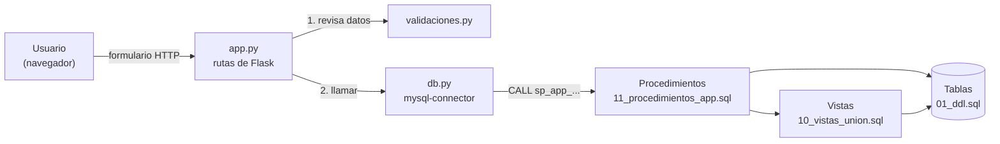

# Documento de arquitectura

Este documento explica cómo la aplicación web usa la base de datos `coworking_db`.
Las instrucciones para instalarla están en el [README](../../README.md).

---

## 1. Visión general

La aplicación tiene tres capas. Cada una solo habla con la siguiente.



*Figura 1. Capas de la aplicación.*

| Archivo | Responsabilidad |
|---|---|
| `app/app.py` | Recibe cada petición del navegador, valida el formulario, llama un procedimiento y muestra el resultado |
| `app/validaciones.py` | Revisa formato, rangos y campos obligatorios antes de ir a la base de datos |
| `app/db.py` | Abre la conexión, ejecuta el procedimiento y traduce los errores de MySQL a mensajes claros |
| `app/templates/` | Páginas HTML (plantillas Jinja) |
| `sql/11_procedimientos_app.sql` | Toda la lógica que lee o modifica datos, con sus transacciones |
| `sql/10_vistas_union.sql` | Las vistas que arman la ficha de cliente, el catálogo de espacios y el resumen de reservas |

**En el código Python no hay SQL.** La aplicación solo conoce nombres de procedimientos y sus parámetros.
Si mañana cambia una tabla, se ajusta el procedimiento y la aplicación sigue igual.

---

## 2. Cómo se conecta la aplicación a la base de datos

- **Librería:** `mysql-connector-python`, el conector oficial de MySQL para Python.
- **Credenciales:** se leen del archivo `.env` con `python-dotenv`. Ese archivo no se sube a GitHub; en el repositorio solo está `.env.example`, sin contraseña.
- **Una conexión por operación:** `db.llamar()` abre la conexión, ejecuta un procedimiento y la cierra en un `finally`, haya error o no. Para una aplicación con pocos usuarios es lo más simple y no deja conexiones abiertas.
- **`autocommit=True`:** la aplicación nunca abre transacciones. Cada procedimiento que modifica datos abre la suya con `START TRANSACTION` y la cierra con `COMMIT` o `ROLLBACK`.
- **Llamada:** `cursor.callproc(nombre, parametros)`. Los resultados de los `SELECT` del procedimiento se leen con `cursor.stored_results()`, y los parámetros `OUT` (por ejemplo el id de la reserva creada) llegan en la tupla que devuelve `callproc`.

```python
# Así crea una reserva app.py (resumido)
_, salida = llamar("sp_app_crear_reserva", cliente_id, modalidad_id, fecha,
                   hora_inicio, hora_fin, espacio_1, espacio_2, espacio_3,
                   anticipo, metodo_pago, None)
reserva_id = salida[-1]   # parámetro OUT p_reserva_id
```

### Procedimientos que usa la aplicación

| Operación | Procedimiento | Tablas que modifica |
|---|---|---|
| Consultar catálogos | `sp_app_listar_catalogos` | — |
| Consultar espacios | `sp_app_listar_espacios` | — |
| Consultar clientes | `sp_app_listar_clientes`, `sp_app_obtener_cliente` | — |
| **Crear cliente** (transacción) | `sp_app_registrar_cliente` | CLIENTE, PERSONA_NATURAL o EMPRESA, TELEFONO_CLIENTE |
| Actualizar cliente | `sp_app_actualizar_cliente` | CLIENTE, subclase, TELEFONO_CLIENTE |
| Eliminar cliente | `sp_app_eliminar_cliente` | CLIENTE (y en cascada subclase y teléfonos) |
| Consultar reservas | `sp_app_listar_reservas`, `sp_app_detalle_reserva` | — |
| **Crear reserva** (transacción) | `sp_app_crear_reserva` (usa `sp_app_agregar_espacio`) | RESERVA, RESERVA_ESPACIO, CUOTA |
| Registrar pago | `sp_app_pagar_cuota` | CUOTA y RESERVA |
| Cambiar estado | `sp_app_cambiar_estado` | RESERVA y CUOTA |
| Eliminar reserva | `sp_app_eliminar_reserva` | RESERVA (y en cascada espacios y cuotas) |

---

## 3. Dónde vive la transacción, y por qué

Las transacciones están **dentro de los procedimientos**, no en Python.

Había dos opciones:

| Opción | Ventaja | Problema |
|---|---|---|
| La aplicación abre la transacción y ejecuta varios `INSERT` | El flujo se lee en Python | Obliga a escribir SQL en la aplicación, que el proyecto no permite. Y otra aplicación podría olvidar el `ROLLBACK` |
| **El procedimiento abre y cierra la transacción** (la elegida) | La regla "todo o nada" queda en la base de datos y se cumple sin importar quién la llame | El flujo se lee en SQL |

Todos los procedimientos que modifican datos siguen el mismo esquema:

```sql
DECLARE EXIT HANDLER FOR SQLEXCEPTION
BEGIN
    ROLLBACK;   -- deshace todo lo que alcanzó a hacer
    RESIGNAL;   -- y devuelve el error original a quien llamó
END;

-- validaciones con SIGNAL ...
START TRANSACTION;
-- INSERT / UPDATE / DELETE en varias tablas ...
COMMIT;
```

Cualquier error después de `START TRANSACTION` cae en el handler: un `SIGNAL` propio, una llave foránea, un `CHECK` o un valor repetido.
El handler hace `ROLLBACK` y con `RESIGNAL` le pasa a la aplicación el mismo error, con su mensaje.

`sp_app_registrar_cliente` tiene además un handler específico para el error 1062 (valor repetido en un `UNIQUE`).
MySQL usa el handler más específico, así que en vez del mensaje técnico de MySQL el usuario lee *"El documento o NIT ya está registrado en otro cliente. No se guardó ningún dato."*

---

## 4. Flujo de una operación de punta a punta: crear una reserva

```mermaid
sequenceDiagram
    actor U as Usuario
    participant A as app.py
    participant V as validaciones.py
    participant D as db.py
    participant P as sp_app_crear_reserva
    participant BD as Tablas

    U->>A: POST /reservas/nueva (formulario)
    A->>V: validar_reserva(datos)
    alt hay errores de formato
        V-->>A: lista de errores
        A-->>U: muestra los errores (no se toca la base)
    else datos válidos
        A->>D: llamar("sp_app_crear_reserva", ...)
        D->>P: CALL con 11 parámetros
        P->>BD: valida cliente, modalidad, fecha y horario de la sede
        P->>BD: START TRANSACTION
        P->>BD: INSERT reserva (PENDIENTE)
        loop por cada espacio (1 a 3)
            P->>BD: ¿misma sede? ¿cruce de horario? ¿tiene tarifa?
            P->>BD: INSERT reserva_espacio con la tarifa vigente
        end
        P->>BD: INSERT cuota(s) y UPDATE estado
        alt todo salió bien
            P->>BD: COMMIT
            P-->>D: OUT p_reserva_id
            D-->>A: (tablas, salida)
            A-->>U: redirige al detalle: "Reserva N creada"
        else un espacio está ocupado (u otro error)
            P->>BD: SIGNAL → handler → ROLLBACK
            P-->>D: error 1644 con el mensaje
            D-->>A: ErrorBD("El espacio N ya está reservado...")
            A-->>U: muestra el mensaje; el formulario conserva los datos
        end
    end
```

*Figura 2. Crear una reserva, con el camino de éxito y el de error.*

Paso a paso, en el caso de error:

1. El usuario pide los espacios 12 y 13 de 10:00 a 12:00. El espacio 13 ya está ocupado de 09:00 a 11:00.
2. `validaciones.py` no puede saberlo, porque depende de otras reservas. Los datos tienen buen formato y pasan.
3. El procedimiento abre la transacción, inserta la reserva y agrega el espacio 12, que está libre.
4. Al revisar el espacio 13 encuentra el cruce y lanza `SIGNAL SQLSTATE '45000'`.
5. El handler hace `ROLLBACK`: desaparecen la fila de RESERVA y la de RESERVA_ESPACIO del espacio 12.
6. `db.py` recibe el error 1644 y como mensaje usa el texto del `SIGNAL`.
7. La página muestra *"El espacio 13 ya está reservado en ese horario. No se guardó la reserva."*

La prueba `test_rollback_reserva_con_espacio_ocupado_no_deja_cambios` reproduce exactamente este caso y comprueba que las tablas quedan con las mismas filas que antes.

---

## 5. Manejo de errores

El usuario nunca ve un error técnico de MySQL. `db.traducir_error()` convierte cada uno en un mensaje claro:

| Código MySQL | Cuándo pasa | Mensaje que ve el usuario |
|---|---|---|
| 1644 | Un `SIGNAL SQLSTATE '45000'` de un procedimiento | El texto escrito en el `SIGNAL`, por ejemplo *"La reserva tiene pagos registrados: cancélela en lugar de eliminarla."* |
| 1062 | Valor repetido en una columna `UNIQUE` | *"Ese dato ya está registrado y no se puede repetir."* |
| 1451 / 1452 | Se rompe una llave foránea | *"La operación rompe una relación con otros datos (llave foránea)."* |
| 3819 | No se cumple un `CHECK` | *"Un valor no cumple las reglas de la base de datos (restricción CHECK)."* |
| 1045, 1049, 2003, 2005 | No hay conexión, el usuario o la contraseña están mal, o la base no existe | *"No fue posible conectarse a la base de datos. Revise que MySQL esté encendido y los datos del archivo .env."* |
| 1305 | Falta un procedimiento | *"Falta un procedimiento en la base de datos. Ejecute los scripts SQL en el orden del README."* |
| Cualquier otro | — | *"Error de la base de datos (código). No se guardaron cambios."* |

Los mensajes de error que vienen de un formulario se muestran en la misma página y el formulario conserva lo que el usuario escribió.

### Cómo funciona SIGNAL SQLSTATE

`SIGNAL SQLSTATE '45000' SET MESSAGE_TEXT = '...'` lanza un error a propósito desde un procedimiento.
El estado `45000` significa "excepción definida por el usuario" y MySQL lo entrega con el código 1644.
Sirve para detener el procedimiento en cuanto una entrada es inválida (una reserva que no existe, un espacio ocupado), en lugar de dejar que siga y falle en silencio o con un mensaje confuso.
Como es un error de verdad, también activa el `EXIT HANDLER` y provoca el `ROLLBACK`.

---

## 6. Validaciones: cuáles van en la aplicación y cuáles en la base de datos

| Validación | Aplicación | Base de datos | Por qué ahí |
|---|---|---|---|
| Campos obligatorios | Sí | `NOT NULL` | La aplicación avisa todos los campos que faltan a la vez; `NOT NULL` es la red de seguridad |
| Formato de email, teléfono, documento y NIT | Sí | No | Es formato de texto: se revisa con expresiones regulares en Python, sin gastar una consulta |
| Mayor de edad | Sí | No | Regla del formulario, con la fecha de hoy |
| Fecha de reserva futura, hora fin > hora inicio | Sí | Sí (`SIGNAL` y `CHECK (fin > inicio)`) | La aplicación responde rápido; la base lo exige aunque alguien la use sin la aplicación |
| Anticipo ≥ 0 y método de pago | Sí | Sí (`SIGNAL`, `CHECK (monto > 0)`) | Igual que la anterior |
| Tipo de cliente, estado, modalidad | Listas cerradas en el formulario | `CHECK ... IN (...)` | El formulario no deja escribir otro valor; el `CHECK` lo garantiza |
| Documento, NIT y email no repetidos | No | `UNIQUE` y `SIGNAL` | Depende de los datos guardados: solo la base lo sabe con certeza |
| Espacio libre en ese horario | No | `SIGNAL` en `sp_app_agregar_espacio` | Depende de otras reservas y debe revisarse dentro de la misma transacción que inserta |
| Espacio con tarifa para la modalidad | No | `SIGNAL` | Depende de la tabla TARIFA |
| Todos los espacios de una reserva en la misma sede | No | `SIGNAL` | Depende de la sede guardada de cada espacio |
| Anticipo no mayor que el valor total | No | `SIGNAL` | El total solo se conoce después de calcular las tarifas |
| No borrar clientes con reservas ni reservas con pagos | No | `SIGNAL` | Protege el historial de pagos aunque se intente borrar por fuera de la aplicación |

En resumen: **la aplicación revisa lo que se puede saber mirando solo el formulario. La base de datos revisa lo que depende de los datos guardados y vuelve a exigir lo crítico**, porque la aplicación no es la única forma de escribir en ella.

---

## 7. Decisiones de seguridad

- **Sin contraseñas en el código.** Las credenciales están en `.env`, que está en `.gitignore`.
- **Sin inyección SQL.** La aplicación no arma SQL con texto: `callproc` envía los valores como parámetros, y el texto que escribe el usuario nunca se interpreta como SQL.
- **Permisos mínimos (opcional).** El README explica cómo crear el usuario `coworking_app` con solo `SELECT` y `EXECUTE`. Con ese usuario la aplicación no puede borrar una tabla ni escribir por fuera de los procedimientos, porque estos se ejecutan con los permisos de quien los creó (`SQL SECURITY DEFINER`, el valor por defecto).
- **Mensajes sin detalles internos.** El usuario no ve trazas de Python ni errores crudos de MySQL.
- **Borrados protegidos.** Eliminar pide confirmación en el navegador y la base de datos rechaza borrar lo que tiene historial.
- **Modo de depuración apagado** por defecto (`FLASK_DEBUG` no está activo).

---

## 8. Pruebas automáticas

Están en `tests/` y se corren con `python -m pytest -v`.

| Prueba | Qué comprueba |
|---|---|
| `test_validaciones.py` (8 pruebas) | Datos válidos sin errores; email y teléfono mal escritos; menor de edad; NIT sin dígito de verificación; fecha pasada y horas invertidas; reserva por día sin horas; espacio repetido y anticipo sin método |
| `test_crear_reserva_con_anticipo_guarda_las_tres_tablas` | La reserva queda CONFIRMADA, con su espacio y con la cuota 1 pagada y la 2 pendiente |
| `test_rollback_reserva_con_espacio_ocupado_no_deja_cambios` | **El ROLLBACK deja los datos sin cambios**: se cuentan las filas de 7 tablas antes y después de una reserva que falla a mitad de camino |
| `test_rollback_anticipo_mayor_al_total` | Un error que aparece después de insertar los espacios también deshace todo |
| `test_rollback_cliente_con_documento_repetido_no_deja_cliente` | El INSERT en CLIENTE se deshace cuando falla el de PERSONA_NATURAL |
| `test_registrar_empresa_guarda_las_tres_tablas` | El flujo de cliente guarda CLIENTE, EMPRESA y TELEFONO_CLIENTE |
| `test_pagar_cuota_confirma_una_reserva_pendiente` | Pagar la primera cuota cambia la reserva a CONFIRMADA |
| `test_no_se_elimina_un_cliente_con_reservas` | El `SIGNAL` impide borrar historial |

Las pruebas de rollback no pueden usar una transacción externa para "deshacer al final", porque el procedimiento ya abre la suya.
Por eso cuentan las filas de cada tabla antes y después y comparan.

---

## 9. Limitaciones conocidas

- Una reserva desde la aplicación incluye de uno a tres espacios, todos con el mismo horario. La base de datos admite más, con horarios distintos por espacio.
- La modalidad por día reserva un solo día, con el horario completo de la sede.
- La aplicación está pensada para correr en el computador local (`127.0.0.1`), no para publicarse en internet: no tiene inicio de sesión ni protección CSRF.
